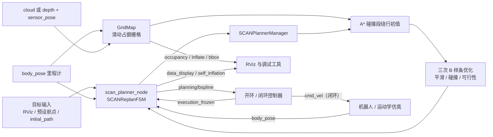
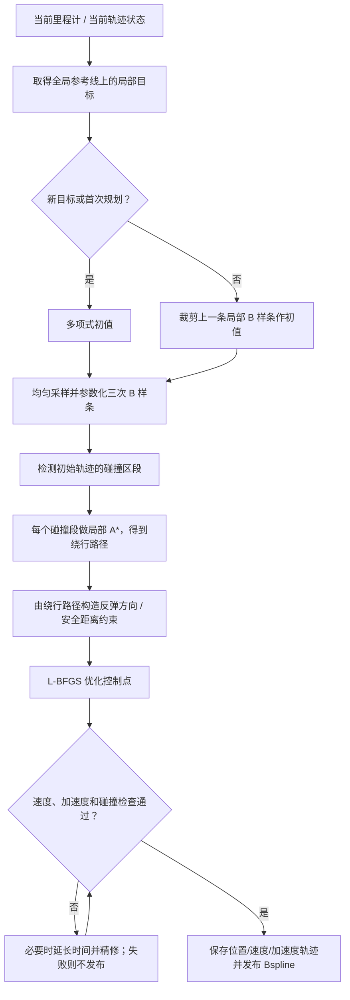
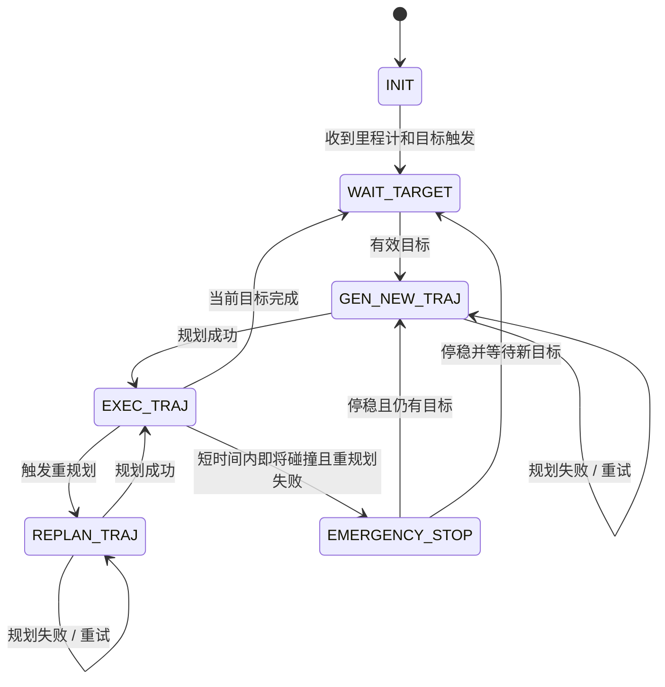

# 代码仓库理解与开发调试指南

本文面向首次阅读代码的开发者，说明当前工作区中四足机器人局部规划程序的模块职责、算法原理、ROS 2 接口、数据流、参数含义及调试步骤。内容以 `src/SCAN-Planner` 中的实际实现为准；既有的[导航技术方案](./四足机器人三维导航与局部避障技术方案.md)描述的是算法设计方案，二者的范围和实现细节并不完全相同。

> **工作区状态提示：** 当前父仓库将 `src/` 显示为未跟踪目录，而 `src/SCAN-Planner` 内另有独立的 Git 元数据。提交代码前先确认团队希望将该目录作为子模块、子仓库还是纳入父仓库；不要假设父仓库的提交会包含其中源码。

## 1. 项目概览

这是一个 ROS 2 Humble / Ubuntu 22.04 / C++17 的规划与仿真工作区。规划主程序将局部点云或深度图转换为滚动 3D 占据栅格，在参考路线附近选择局部目标，用碰撞感知 A* 为碰撞段提供绕行初值，再优化三次 B 样条并发布给开环或闭环控制器。

### 1.1 模块关系



### 1.2 源码导航

| 子目录 | 职责 | 主要入口 |
|---|---|---|
| `src/planner/plan_manage`（ROS 包名 `scan_planner`） | FSM、规划管理、控制器、启动配置 | [`scan_replan_fsm.cpp`](../src/SCAN-Planner/src/planner/plan_manage/src/scan_replan_fsm.cpp)、[`planner_manager.cpp`](../src/SCAN-Planner/src/planner/plan_manage/src/planner_manager.cpp)、[`run.launch.py`](../src/SCAN-Planner/src/planner/plan_manage/launch/run.launch.py) |
| `src/planner/plan_env`（`plan_env`） | 3D 栅格、点云/深度融合、占据膨胀、滑动地图 | [`grid_map.cpp`](../src/SCAN-Planner/src/planner/plan_env/src/grid_map.cpp)、[`grid_map.h`](../src/SCAN-Planner/src/planner/plan_env/include/plan_env/grid_map.h) |
| `src/planner/path_searching`（`path_searching`） | 为碰撞路段搜索离散绕行路径 | [`dyn_a_star.cpp`](../src/SCAN-Planner/src/planner/path_searching/src/dyn_a_star.cpp) |
| `src/planner/bspline_opt`（`bspline_opt`） | 均匀 B 样条、碰撞反弹与轨迹精修 | [`bspline_optimizer.cpp`](../src/SCAN-Planner/src/planner/bspline_opt/src/bspline_optimizer.cpp)、[`uniform_bspline.cpp`](../src/SCAN-Planner/src/planner/bspline_opt/src/uniform_bspline.cpp) |
| `src/planner/traj_utils`（`traj_utils`） | 多项式参考轨迹与 RViz 可视化 | `polynomial_traj.*`、`planning_visualization.*` |
| `src/planner/scan_planner_msgs` | 自定义轨迹和显示消息 | [`Bspline.msg`](../src/SCAN-Planner/src/planner/scan_planner_msgs/msg/Bspline.msg)、[`DataDisp.msg`](../src/SCAN-Planner/src/planner/scan_planner_msgs/msg/DataDisp.msg) |
| `src/simulator/mockamap`、`map_generator`、`local_sensing` | 合成地图、PCD 地图发布、传感器模拟 | `simulator.launch.py` |
| `src/simulator/Utils`、`go2_description` | Go2 模型、运动学/显示工具 | `go2_sim.launch.py`、`go2_rviz.launch.py` |

## 2. 算法与数据流

### 2.1 地图输入与坐标约定

`GridMap` 根据 `grid_map.sensor_type` 选择输入：

- **LiDAR：** 订阅 `cloud` 与 `sensor_pose`。点云由 `cloud_is_world=true` 决定是已经在世界坐标系，还是需要用最新传感器位姿变换；`need_extrinsic` 为真时再叠加代码内的 LiDAR 外参。此路径没有按点云 `frame_id` 查询 TF，坐标变换完全由参数和传感器位姿决定。
- **深度相机：** 对 `depth` 图像与 `sensor_pose` 使用 `message_filters` 同步，按内参反投影后变换到地图坐标系；深度图以 `k_depth_scaling_factor` 从整数像素值还原米制深度。
- `body_pose` 由规划 FSM 获取机器人位置、速度和姿态，也用于发布 `sliding_map` 可视化 TF。占据栅格的实际滑动中心来自 `sensor_pose`（射线原点）。**机身里程计不能代替传感器位姿**；LiDAR 点云融合在收到有效 `sensor_pose` 之前会跳过。

模拟启动会把传感器和机身里程计映射到 `/quad_0/...`。实机启动默认映射到 `/LIO/odom_vehicle`、`/LIO/odom_imu`、`/LIO/clouds_lidar` 或 `/camera/aligned_depth_to_color/image_raw`。实际驱动的坐标系、时间戳、点云坐标定义不同时，应先改启动映射或输入适配，再调算法权重。

### 2.2 3D 占据与膨胀

地图以分辨率 `r` 将 3D 空间离散为体素。每个体素使用 log-odds 占据值，命中/空闲射线更新可写为：

\[
L_t(v)=\operatorname{clip}\left(L_{t-1}(v)+
\begin{cases}
\log\frac{p_{hit}}{1-p_{hit}}, & \text{射线终点命中}\\
\log\frac{p_{miss}}{1-p_{miss}}, & \text{射线穿过}
\end{cases},
L_{min},L_{max}\right)
\]

当 `L_t(v) > logit(p_occ)` 时体素被认定为占据。点云/深度终点作为 hit，射线经过体素作为 miss；同一批观测先累计，再批量更新。占据栅格按传感器射线原点滑动，离开滑窗的体素清空，避免长期导航中地图范围固定在起点。

占据体素的膨胀区域由两个量控制：水平面内以 `double_cylinder_radius` 构造圆形膨胀，竖直方向分别向上、向下扩展 `obstacles_inflation_z_up/down`。机器人碰撞查询不是用完整网格模型，而是沿估计航向在机身中心前后各取一个点：

\[
p_{front/rear}=p\pm d\,[\cos\psi,\sin\psi,0]
\]

只要任一点落入膨胀占据层，或查询点越出地图，`getInflateOccupancy` 就返回非零（越界返回 `-1`，调用方按碰撞处理）。因此地图范围、机身中心高度、膨胀量和航向估计必须一致。

#### 机身竖直包络、`body_height` 与可跨台阶高度

调试低矮障碍时，需要区分“轨迹参考点高度”“机身碰撞包络”和“障碍物高度”。论文中的 \(d_\mathrm{up}\)、\(d_\mathrm{down}\) 是相对于机器人参考中心 \(z_c\) 的机身竖直尺寸；\(d_\mathrm{step}\) 是允许跨越的最大台阶高度。若局部地面高度为 \(z_g\)，则机身包络的下边界为：

\[
z_\mathrm{bottom}=z_c-d_\mathrm{down}
              =z_g+d_\mathrm{step},
\qquad
d_\mathrm{down}=z_c-z_g-d_\mathrm{step}.
\]

机身上边界为 \(z_\mathrm{top}=z_c+d_\mathrm{up}\)。因此，\(d_\mathrm{down}\) 应让机身下边界落在可跨台阶的高度上；\(d_\mathrm{up}\) 应覆盖机器人中心上方的机身、传感器等硬件并留出余量。障碍顶部低于下边界时，不应仅因机身碰撞模型而阻挡；障碍进入包络时则按碰撞处理。这是几何近似，不是腿部或足端的步态可达性判断。

**当前代码没有单独的 `d_step` 参数或“按障碍高度分类”的逻辑。**它通过占据膨胀与轨迹点查询间接实现上述几何边界：

- `GridMap::rebuildInflationOffsets` 将每个占据体素的竖直偏移从 `-ceil(obstacles_inflation_z_down / resolution)` 扩展到 `+ceil(obstacles_inflation_z_up / resolution)`。参数名表示**占据地图的扩张方向**，而不是机身的尺寸方向。
- 碰撞查询检查 B 样条采样点沿航向的前、后两个代表点是否落入膨胀层。查询点落入即报告碰撞；地图外也按碰撞处理。
- 因而，在碰撞查询高度与局部地面近似固定时，代码的 `obstacles_inflation_z_up` 大致对应论文机身向下尺寸 \(d_\mathrm{down}\)，`obstacles_inflation_z_down` 大致对应机身向上尺寸 \(d_\mathrm{up}\)。这是由“膨胀障碍再查询机身点”的几何等价关系得出的，不是同名参数的一一对应。实现见 [`grid_map.cpp`](../src/planner/plan_env/src/grid_map.cpp) 和 [`grid_map.h`](../src/planner/plan_env/include/plan_env/grid_map.h)。

离散体素下，可以用下面的关系估算实际高度边界。令分辨率为 \(r\)，查询点体素索引 \(q_z=\lfloor z_c/r\rfloor\)，向上膨胀步数 \(N_\mathrm{up}=\lceil\texttt{obstacles\_inflation\_z\_up}/r\rceil\)。若障碍顶面所在体素索引为 \(k_\mathrm{top}\)，在水平位置重叠且该顶面被观测为占据的前提下，当

\[
k_\mathrm{top}+N_\mathrm{up}\ge q_z
\]

时，顶面可膨胀到查询高度，可能触发碰撞。对应的地面相对临界高度近似为：

\[
d_\mathrm{step,eff}\approx(q_z-N_\mathrm{up})r-z_g.
\]

实际值还受体素边界、障碍点云覆盖、水平膨胀范围和机器人航向影响；它不是独立测得或存入地图的“可跨高度标签”。

**`z_c` 的来源：** 碰撞接口收到的是轨迹采样点，因此规划过程中的 \(z_c\) 是当前 B 样条轨迹采样点的 Z，而非点云测得的障碍高度。局部重规划起点来自 `body_pose` 里程计。导航模式也会影响轨迹 Z：`navi_mode=1` 的目标高度取首次收到的机身里程计 Z；`navi_mode=2` 使用显式航点 Z；`navi_mode=3` 将输入 `nav_msgs/Path` 点的 Z 加上 `grid_map.body_height`。所以 `body_height` 不是机身上沿，也不保证所有模式下都等于 \(z_c\)；只有在模式 3 且输入路径 Z 表示地面高度时，它才是地面到规划参考点的高度偏移。相关逻辑见 [`scan_replan_fsm.cpp`](../src/planner/plan_manage/src/scan_replan_fsm.cpp)。

**当前默认值的解读示例：** 配置为 `resolution=0.05` m、`obstacles_inflation_z_up=0.1` m，向上扩张为 2 个体素。若某次碰撞查询的 \(z_c=0.40\) m 且地面 \(z_g=0\)，则估算的临界高度约为 \(0.30\) m；若 \(z_c=0.30\) m，则约为 \(0.20\) m。这个示例说明默认值不能直接解释为“7 cm 可跨、10 cm 绕行”。配置见 [`planner.yaml`](../src/planner/plan_manage/config/planner.yaml)；应使用实际轨迹采样高度而不是仅凭 `body_height` 推断。

**设置和验证 7 cm / 10 cm 规则：**

1. 先确认碰撞查询点的实际 \(z_c\)、障碍位置的局部地面 \(z_g\)，以及输入点云是否完整覆盖障碍顶部。`grid_map.ground_height` 是地图竖直范围的基准，不是对起伏地面的局部估计。
2. 选择 7 cm 与 10 cm 之间的有效边界，例如约 8 cm；平地、固定 \(z_c\) 条件下按 \(d_\mathrm{down}=z_c-z_g-d_\mathrm{step}\) 估算，并换算到代码的向上膨胀量。边界应留出感知误差和体素取整的裕量。
3. 当前各向同性体素分辨率为 5 cm，竖直边界按体素取整，不能可靠保证 3 cm 间隔的分类。缩小 `grid_map.resolution` 会同时增大 XYZ 三个方向的体素数量；若需要厘米级竖直分辨能力，应评估内存和计算开销，或增加独立的局部高度/可通行性表示，而不是未经评估地把整张 3D 地图改成 1 cm 分辨率。
4. 在预定轨迹正前方放置高度已知、且与双圆柱水平碰撞范围重叠的障碍（例如 7、8、10、12 cm），分别验证原始占据、`grid_map/occupancy_inflate` 和规划器碰撞查询：7 cm 应不触发机身碰撞，10 cm 及以上应触发绕行。还需改变障碍水平位置、朝向、观测距离和点云噪声，排查漏观测及体素边界效应。
5. 最后单独验证真实机器人是否能跨过低障碍。当前碰撞近似不检查完整腿部、关节、足端与步态动力学；“规划器未检测到机身碰撞”不等于控制器一定能安全跨越。

**未知空间注意事项：** 未观测体素初始化为未知，但膨胀层初始为 0；当前 A* 与轨迹碰撞判断主要查询膨胀层，所以未知空间不会自动视为障碍。需要保守探索时，应在传感器覆盖、地图边界或规划层补足未知空间策略，不能仅依靠调大碰撞权重。

### 2.3 全局参考路线与局部目标

全局轨迹是参考，不是全局避障路径：

1. `navi_mode=1`：RViz 的 2D goal 只使用目标 XY；目标 Z 固定为首次收到的 `body_pose.z`。
2. `navi_mode=2`：从 `fsm.waypoints` 读取按 `[x,y,z,...]` 展平的数组；首次收到里程计后自动执行，航点按序推进。
3. `navi_mode=3`：接收 `nav_msgs/Path` 类型的 `initial_path`；实现对每个输入点的 Z 加上 `grid_map.body_height`。

管理器把起点、终点/航点转换为分段多项式参考轨迹，远距离航点之间插入中间点，并根据距离和最大速度分配时间。FSM 在参考线上按 `fsm.planning_horizon` 选择局部目标；如果局部目标被膨胀地图占据，会沿参考轨迹搜索附近可用点。

### 2.4 局部初始化、A* 与 B 样条优化

局部规划的主要步骤如下：



#### A* 的职责与范围

A* 只为 B 样条控制点附近检测出的碰撞段提供离散绕行初值，并非独立的全局规划器。当前搜索在 XY 平面使用 8 邻接；Z 按起终点连线在搜索平面上插值。节点碰撞判断仍使用机身双圆柱模型。搜索结果随后转换为连续的反弹方向，供优化器推开控制点。

#### 优化目标

碰撞反弹阶段的主要目标可概括为：

\[
J_{rebound}=\lambda_s J_{smooth}
+\lambda_c J_{collision}
+\lambda_f J_{feasibility}
\]

其中平滑项使用三阶控制点差分（近似 jerk）平方和；碰撞项根据 A* 提供的安全基点和法向方向惩罚控制点到安全距离 `dist0` 的不足；可行性项惩罚超出速度/加速度限制的控制点差分。时间精修阶段改用参考线贴合项替换碰撞项：

\[
J_{refine}=\lambda_s J_{smooth}
+\lambda_{fit}J_{fitness}
+\lambda_fJ_{feasibility}
\]

优化器固定端部控制点，对中间控制点进行 L-BFGS 优化；若 B 样条速度/加速度检查失败，会按测得比例延长时间、重新参数化并精修。发布前还会采样检查速度和加速度上限。

**当前实现边界：**

- 优化梯度的 Z 行被明确置零，反弹/精修优化不会主动调整 B 样条高度控制点。垂直越障、跨台阶或主动选择高低绕行高度不能视为已实现能力。
- `manager.max_jerk` 会从参数读取，但管理器的最终动态可行性检查只检查速度和加速度；平滑项使用 jerk 差分不等价于 jerk 上限约束。
- 规划器碰撞模型是双圆柱近似，不能替代真实机器人足端、摆动腿或完整碰撞几何的安全验证。
- 优化器的候选轨迹碰撞检查偏重前 2/3 时域；运行时安全回调也在当前时间落于前 2/3 时先检查到该分界，进入后段后再检查余下部分。这是滚动重规划逻辑，不是一次性全轨迹连续安全证明。

### 2.5 FSM、在线安全检查和急停

FSM 每 10 ms 驱动状态机；地图融合与可视化各由 50 ms 定时器驱动。典型状态流如下：



安全回调以 50 ms 周期运行，并以 10 ms 时间步检查当前局部轨迹。发现障碍时优先尝试基于当前状态重规划；若预测碰撞时间小于 `fsm.emergency_time` 且重规划失败，则切到 `EMERGENCY_STOP`。急停轨迹由当前位置重复控制点生成。连续失败达到 `fsm.max_replan_fail_count` 后进入急停并等待新目标。

闭环控制器在航向误差过大时先原地转向，并通过 `planning/go2_execution_frozen` 通知规划器暂停局部轨迹时间推进，避免机器人未沿轨迹移动但轨迹时钟持续前进。

## 3. ROS 2 接口

### 3.1 规划器输入输出

| 话题（规划器内部相对名） | 类型 | 用途 | 启动映射/说明 |
|---|---|---|---|
| `body_pose` | `nav_msgs/msg/Odometry` | 机器人位姿、速度；滑动地图跟随 | 仿真 `/quad_0/body_pose`；实机 `/LIO/odom_vehicle` |
| `sensor_pose` | `nav_msgs/msg/Odometry` | 传感器射线原点和姿态 | 仿真 LiDAR `/quad_0/lidar_pose`、深度 `/quad_0/camera_pose`；实机 `/LIO/odom_imu` |
| `cloud` | `sensor_msgs/msg/PointCloud2` | LiDAR 点云 | 仿真 `/quad_0/cloud`；实机 `/LIO/clouds_lidar` |
| `depth` | `sensor_msgs/msg/Image` | 深度图 | 仿真 `/quad_0/depth`；实机 `/camera/aligned_depth_to_color/image_raw` |
| `move_base_simple/goal` | `geometry_msgs/msg/PoseStamped` | `navi_mode=1` 目标输入 | `/move_base_simple/goal` |
| `initial_path` | `nav_msgs/msg/Path` | `navi_mode=3` 路线输入 | `/initial_path` |
| `planning/go2_execution_frozen` | `std_msgs/msg/Bool` | 控制器冻结/恢复局部轨迹时钟 | 仿真和实机均为 `/planning/go2_execution_frozen` |
| `planning/bspline` | `scan_planner_msgs/msg/Bspline` | 局部轨迹输出 | 控制器输入；实机/仿真均为 `/planning/bspline` |
| `planning/data_display` | `scan_planner_msgs/msg/DataDisp` | 调试显示消息 | 当前实现仅设置 header 时间戳，`a` 至 `e` 未赋值 |
| `self_inflation` | `visualization_msgs/msg/Marker` | 显示机身双圆柱碰撞近似 | 蓝色圆柱 Marker |

地图可视化话题包括 `grid_map/occupancy`、`grid_map/occupancy_inflate`、`grid_map/unknown`、`grid_map/depth_cloud`、`grid_map/sliding_map_bbox` 和 `grid_map/sensor_pose_extrinsic`。默认没有额外 namespace 时，完整话题名以 `/` 开头。

### 3.2 轨迹消息格式

`scan_planner_msgs/msg/Bspline` 的字段：

| 字段 | 含义 |
|---|---|
| `order` | B 样条阶数；规划器当前发布为 3（三次） |
| `traj_id` | 新轨迹递增编号 |
| `start_time` | 轨迹开始时间戳 |
| `knots` | 节点向量 |
| `pos_pts` | 位置控制点 |
| `yaw_pts`、`yaw_dt` | 消息中定义，但规划器当前未填充，控制器也不读取 |

闭环控制器收到新轨迹后从本地执行时间 0 开始评估位置；它根据前视点切向估计期望航向。开环控制器则使用 `start_time` 与当前 ROS 时间计算轨迹进度，并把轨迹评估值作为 `body_pose` 发布。混用仿真时间和系统时间可能导致开环轨迹等待或进度异常。

### 3.3 核心 C++ 调用接口

| 类/方法 | 输入/输出职责 | 调用关系 |
|---|---|---|
| `SCANReplanFSM::init(node)` | 读取 FSM 参数、初始化地图/管理器、创建订阅发布器和定时器 | `scan_planner_node` 入口创建并持有 FSM |
| `SCANPlannerManager::initPlanModules(node, vis)` | 初始化地图、优化器、A* 及速度/加速度等规划参数 | FSM 初始化时调用 |
| `SCANPlannerManager::planGlobalTraj(...)` / `planGlobalTrajWaypoints(...)` | 建立单目标或多航点多项式参考轨迹 | 手动目标、预设目标、参考路径回调调用 |
| `SCANPlannerManager::reboundReplan(...)` | 以起终状态和局部目标生成、优化、校验局部 B 样条 | FSM 生成新轨迹或重规划时调用 |
| `SCANPlannerManager::EmergencyStop(pos)` | 建立当前位置的静止 B 样条 | FSM 急停状态调用 |
| `GridMap::initMap(node)` / `getInflateOccupancy(pos, yaw)` | 初始化地图接口；按航向查询机器人近似碰撞状态 | 管理器、A*、优化器和安全回调共享 |
| `AStar::AstarSearch(resolution, start, end)` | 在地图中搜索一段离散绕行路径 | 优化器检测到碰撞区段时调用 |
| `BsplineOptimizer::initControlPoints(...)` / `BsplineOptimizeTrajRebound(...)` | 生成碰撞段绕行引导并优化控制点 | `reboundReplan` 的局部规划阶段 |
| `BsplineOptimizer::BsplineOptimizeTrajRefine(...)` | 时间重新分配后做参考线精修 | 动态可行性不足时调用 |

上述接口使用 Eigen 3D 向量和矩阵作为内部数据格式；ROS 消息转换集中在 FSM 发布轨迹，以及地图输入回调中。扩展规划算法时优先沿现有 Manager → Map/Optimizer 的依赖关系添加逻辑，不要在控制器中复制地图或优化过程。

## 4. 参数说明与调参方法

参数文件位于 [`planner.yaml`](../src/SCAN-Planner/src/planner/plan_manage/config/planner.yaml)、[`controllers.yaml`](../src/SCAN-Planner/src/planner/plan_manage/config/controllers.yaml) 和 [`simulator.yaml`](../src/SCAN-Planner/src/planner/plan_manage/config/simulator.yaml)。ROS 2 参数名使用点分隔形式。下表给出规划器配置中实际出现的关键项；建议每次只改一个相关参数组并记录前后对比。

### 4.1 FSM 与局部路线

| 参数 | 默认值 | 作用与调试方向 |
|---|---:|---|
| `fsm.navi_mode` | `1` | 1=RViz 目标；2=预设航点；3=外部路径 |
| `fsm.waypoints` | 未配置 | 模式 2 使用的展平 XYZ 数组，元素数必须为 3 的倍数且非空 |
| `fsm.thresh_replan` | `1.0` m | 距离局部轨迹起点超过该阈值后允许触发重规划；过小会增加重规划频率 |
| `fsm.thresh_no_replan` | `0.1` m | 接近终点时不再重复重规划的距离阈值 |
| `fsm.planning_horizon` | `7.5` m | 局部目标距离；调小可缩短单次局部规划范围，调大可能加重搜索与优化负担 |
| `fsm.emergency_time` | `1.0` s | 碰撞预测时间小于此值且重规划失败时优先急停 |
| `fsm.fail_safe` | `true` | 启用停稳后退出急停的恢复逻辑 |
| `fsm.max_replan_fail_count` | `1000` | 连续失败次数阈值，不是秒数；降得过低会更快进入急停 |

### 4.2 地图、感知和机身模型

| 参数 | 默认值 | 作用与调试方向 |
|---|---:|---|
| `grid_map.resolution` | `0.05` m | 体素边长；更细可保留细节但显著增加内存与计算 |
| `grid_map.sliding_map_size_x/y/z` | `10/10/5` m | 规划占据地图尺寸；机器人必须留在地图边界内 |
| `grid_map.local_update_range_x/y/z` | `5/5/2.5` m | 单次传感器融合的局部更新范围 |
| `grid_map.map_sliding_en` | `true` | 是否跟随机身滑动地图 |
| `grid_map.map_sliding_thresh` | `0.2` m | 地图原点达到该位移才滑动；内部会按体素向上取整 |
| `grid_map.double_cylinder_radius` | `0.25` m | 障碍物膨胀半径，也是机身双圆柱横截面半径 |
| `grid_map.double_cylinder_offset` | `0.18` m | 双圆柱相对机身中心沿航向的前后偏移 |
| `grid_map.body_height` | `0.4` m | 仅模式 3 将输入路线点 Z 加此偏移，得到规划参考点高度；不是机身上沿或碰撞尺寸 |
| `grid_map.obstacles_inflation_z_up/down` | `0.1/0.4` m | 占据体素的上下膨胀距离；向上膨胀近似对应机身向下包络，向下膨胀近似对应机身向上包络，具体临界高度还取决于轨迹查询 Z 和体素取整 |
| `grid_map.frame_id` | `world` | 地图和机身碰撞 Marker 所在坐标系 |
| `grid_map.sliding_map_frame_id` | `sliding_map` | 发布的滑动地图坐标系名称 |
| `grid_map.ground_height` | `0.0` m | 地图竖直范围的基准，不是起伏地面的局部高度估计 |
| `grid_map.sensor_type` | `lidar` | `lidar` 或 `depth`；launch 参数会覆盖 YAML |
| `grid_map.cloud_is_world` | `true` | LiDAR 点云是否已为世界坐标；实机传感器坐标点云应设置为 false |
| `grid_map.need_extrinsic` | `false` | 是否叠加源码中固定的传感器外参；更换安装位置需校验/修改外参 |
| `grid_map.fx/fy/cx/cy` | 配置文件内给定 | 深度相机内参；必须匹配输入深度图分辨率和相机标定 |
| `grid_map.depth_filter_maxdist/mindist` | `3.0/0.3` m | 深度有效距离范围；过小会漏掉远障碍，过大会引入噪点 |
| `grid_map.depth_filter_margin` | `1` pixel | 图像边缘剔除宽度 |
| `grid_map.k_depth_scaling_factor` | `1000` | 整数深度缩放因子；原始毫米深度通常为 1000 |
| `grid_map.skip_pixel` | `2` | 深度图像素采样步长；减小可加密投影点但增加负载 |
| `grid_map.p_hit/p_miss` | `0.85/0.30` | 命中/穿越的占据概率更新 |
| `grid_map.p_min/p_max` | `0.12/0.98` | log-odds 更新的概率夹紧范围 |
| `grid_map.p_occ` | `0.80` | 判定体素占据的概率阈值 |
| `grid_map.max_ray_length` | `5.0` m | 最大射线长度 |
| `grid_map.vis_height` | `0.3` m | 占据地图可视化高度过滤参数 |
| `grid_map.show_occ_time` | `false` | 保留的融合耗时开关；当前耗时打印代码已注释 |

### 4.3 轨迹与优化

| 参数 | 默认值 | 作用与调试方向 |
|---|---:|---|
| `manager.max_vel` | `0.75` m/s | 规划器速度限制 |
| `manager.max_acc` | `0.5` m/s² | 规划器加速度限制 |
| `manager.max_jerk` | `4.0` m/s³ | 配置值会读取，但当前最终动态检查没有 jerk 上限判定 |
| `manager.control_points_distance` | `0.2` m | 初值 B 样条控制点间距；影响曲线离散密度和优化规模 |
| `manager.feasibility_tolerance` | `0.5` | 均匀 B 样条动态可行性允许比例容差 |
| `manager.planning_horizon` | `7.5` m | 管理器参数；FSM 的目标截取主要使用 `fsm.planning_horizon` |
| `optimization.lambda_smooth` | `1.0` | 平滑/jerk 差分项权重 |
| `optimization.lambda_collision` | `1.0` | 碰撞反弹距离项权重；障碍边缘仍贴近时可尝试逐步增加 |
| `optimization.lambda_feasibility` | `0.1` | 速度/加速度可行性代价权重 |
| `optimization.lambda_fitness` | `1.0` | 时间精修阶段贴合参考线的权重 |
| `optimization.dist0` | `0.2` m | 碰撞反弹目标安全距离 |
| `optimization.max_vel/max_acc` | `0.75/0.5` | 优化器自身的速度/加速度代价限制；需与 manager 限制同步 |
| `optimization.order` | `3` | B 样条阶数；FSM 发布消息固定为 3，当前实现应保持为 3 |
| `optimization.vel_tolerance/acc_tolerance` | 未显式配置 | 管理器默认读取为 `1.0/1.0`，用于发布前采样可行性检查 |

### 4.4 控制器参数

| 参数 | 配置值 | 用途 |
|---|---:|---|
| `time_forward` | `0.8` s | 闭环期望航向估计的前视时间 |
| `heading_error_threshold` | `0.8` rad | 超过阈值时冻结轨迹时钟并原地转向 |
| `kp_pos` / `kp_yaw` | `0.8` / `1.5` | 闭环位置与航向比例增益 |
| `max_vx` / `max_vy` / `max_vyaw` | `0.75` / `0.35` / `1.0` | 机体坐标系速度限幅；偏航角速度还受代码内 1.0 限制 |
| `finish_dist` | `0.15` m | 轨迹结束后判定到达终点的距离 |
| `publish_rate` | `100` Hz | 开环里程计发布频率 |
| `yaw_min_speed` | `0.05` m/s | 开环速度低于该值时保持上次航向 |
| `hold_final_position` | `true` | 开环轨迹结束后保持末端位置 |
| `init_x/y/z/yaw` | YAML 初值 | 开环模拟器和运动学仿真的初始状态 |
| `cmd_timeout` / `sim_rate` | `0.3` s / `100` Hz | 运动学仿真命令超时和积分频率 |

### 4.5 仿真参数

仿真配置见 [`simulator.yaml`](../src/SCAN-Planner/src/planner/plan_manage/config/simulator.yaml)，只影响地图生成/传感器模拟，不等同于规划器的 `grid_map.*`：

| 参数组 | 关键参数 | 调试用途 |
|---|---|---|
| `mockamap_node` | `seed=127`、`update_freq=0.5`、`resolution=0.1`、`x_length/y_length/z_length=40/40/5` | 固定随机地图；改变 seed 或 `type/complexity/fill/obstacle_number` 可改变场景 |
| `pcl_render_node` 地图 | `map.resolution=0.1`、`map.x_size/y_size/z_size=40/40/5` | 模拟全局环境尺寸；`run.launch.py` 的 `map_size_x/y/z` 会覆盖尺寸 |
| `pcl_render_node` 传感器 | `sensing_horizon=40`、`sensing_rate=10`、`estimation_rate=10`、`downsample_res=0.1` | 点云/深度生成距离、频率与下采样密度 |
| LiDAR | `yaw_fov=360`、`vertical_fov=90`、`min_raylength=1`、`lidar_pitch=45`、雷达 pattern 开关 | 模拟视场、扫描角和传感器模型 |
| 深度相机 | `cam_width/height=640/480`、`cam_fx/fy/cx/cy` | 模拟图像尺寸和内参；需与规划器深度内参对应 |
| 动态障碍 | `dynamic.enable/object_count/mode/velocity` | 配置仿真动态物体；规划器当前没有独立的动态障碍速度预测模型 |
| 地图来源 | launch 参数 `use_pcd_map`、`pcd_map_file` | 使用已有 PCD 替代随机地图；启用时路径必须存在 |
| 渲染后端 | launch 参数 `use_gpu` | `false` 使用 CPU 点云渲染；GPU 需系统 OpenGL/GLEW/GLFW 依赖 |

建议先用固定 `seed` 和 CPU 模式复现规划行为，再启用动态物体或 GPU。仿真器的 `collision_check.enable` 是传感器模拟侧选项，不代表规划器的轨迹碰撞检查已关闭或已通过。

### 4.6 调参顺序

1. **先验证坐标和数据：** 确认 `body_pose`、`sensor_pose`、点云/深度图的 frame、时间戳、单位和朝向；地图整体偏移首先查外参和 `cloud_is_world`，不要先调优化权重。
2. **再调地图：** RViz 同时观察原始占据和膨胀层。漏障碍检查传感器覆盖、最大量程、深度缩放、更新范围、hit/miss；障碍过胖检查 `resolution`、膨胀半径及 Z 上下膨胀。
3. **再调机身模型：** 碰撞误报优先检查机器人中心高度、`double_cylinder_radius/offset` 和航向；窄道误判可检查双圆柱模型是否过保守。
4. **再调局部规划：** 检查目标点与 A* 是否在地图边界内；再调整 `planning_horizon`、控制点距离及碰撞/平滑/可行性权重。每次只改变一组相关量。
5. **最后调控制器：** 先确认轨迹正确，再调速度上限、`kp_pos`、`kp_yaw` 和前视时间。闭环转向停滞优先检查 `heading_error_threshold` 和 odometry yaw；不要通过提高增益掩盖坐标错误。

规划器参数在初始化时读入类成员，代码未注册动态参数回调。`ros2 param set` 即便成功修改 ROS 参数值，也不代表算法中的缓存参数会同步更新；可靠流程是修改 YAML 后重启节点。

## 5. 启动、构建与调试

### 5.1 构建和基本启动

`src/SCAN-Planner` 自身是 colcon 工作区。在具备 ROS 2 Humble、`rosdep`、`colcon` 及系统依赖的环境中：

```bash
cd src/SCAN-Planner
source /opt/ros/humble/setup.bash
rosdep install --from-paths src --ignore-src -r -y
colcon build --symlink-install --cmake-args -DCMAKE_BUILD_TYPE=Release
source install/setup.bash
```

默认 CPU 仿真启动：

```bash
ros2 launch scan_planner run.launch.py \
  is_real_world:=false navi_mode:=1 sensor_type:=lidar \
  controller_mode:=closed_loop use_gpu:=false
```

另一个终端启动 RViz：

```bash
source src/SCAN-Planner/install/setup.bash
ros2 launch scan_planner rviz.launch.py
```

模式 2 示例（路径必须是存在的 ROS 2 参数 YAML 文件）：

```yaml
scan_planner_node:
  ros__parameters:
    fsm.navi_mode: 2
    fsm.waypoints: [0.0, 0.0, 0.3, 2.0, 0.0, 0.3]
```

```bash
ros2 launch scan_planner run.launch.py \
  is_real_world:=false navi_mode:=2 \
  keypoints_file:=/absolute/path/to/keypoints.yaml
```

模式 3 需让上游节点发布 `nav_msgs/msg/Path` 到 `/initial_path`。模式 1 则在 RViz 使用 2D Nav Goal。launch 会校验导航模式、传感器类型和控制器类型；模式 2 还会校验 `keypoints_file` 存在。

### 5.2 建议的逐层检查

#### A. 节点和参数

```bash
ros2 node list
ros2 param list /scan_planner_node
ros2 param get /scan_planner_node fsm.navi_mode
```

先确认参数文件确实加载到了正确节点名。ROS 2 参数文件顶层节点名要匹配 `scan_planner_node`、`closed_loop_controller` 等实际节点名。

#### B. 传感器与里程计

```bash
ros2 topic list
ros2 topic info --verbose /quad_0/body_pose
ros2 topic hz /quad_0/body_pose
ros2 topic hz /quad_0/cloud
ros2 topic echo --once /quad_0/body_pose
```

深度模式检查 `/quad_0/depth` 与 `/quad_0/camera_pose`；实机则检查 launch 中指定的 `/LIO/...` 或相机话题。若日志提示没有 LiDAR `sensor_pose`，点云不会融合。若话题频率正常但地图错位，依次核对 frame、`cloud_is_world`、外参开关、相机内参和时间同步。

#### C. 地图

```bash
ros2 topic hz /grid_map/occupancy
ros2 topic hz /grid_map/occupancy_inflate
ros2 topic echo --once /grid_map/sliding_map_bbox
```

在 RViz 观察原始占据、膨胀层、地图边界和蓝色 `self_inflation` 圆柱。若障碍消失，先看射线是否更新、机器人是否处于地图边界内以及传感器坐标是否正确；若整个地图像被障碍填满，检查坐标系和深度缩放、`p_occ` 与膨胀参数。

#### D. 目标、规划和轨迹

```bash
ros2 topic info --verbose /planning/bspline
ros2 topic echo --once /planning/bspline
ros2 topic echo /planning/go2_execution_frozen
```

若没有轨迹，按顺序确认：收到里程计 → 收到目标/路径 → 全局多项式生成成功 → 局部目标在滑动地图中 → A* 找到可行通道 → 优化器未拒绝碰撞或动态不可行轨迹。关注控制台中的 `Unable to generate global trajectory`、`A-star failed`、`Dynamic feasibility failed`、`Unable to refresh global trajectory` 和连续失败急停日志。

#### E. 控制器和执行

闭环模式：

```bash
ros2 topic hz /quad_0/cmd_vel
ros2 topic echo --once /quad_0/cmd_vel
```

实机的闭环输出映射为 `/cmd_vel`。确认控制器订阅到 `/planning/bspline` 和 `body_pose`，同时确保机器人驱动使用相同速度坐标约定。若规划轨迹在 RViz 正常但机器人不动，问题通常在控制话题映射、驱动接口或控制器限幅，而不是地图优化。

开环模式不生成真实速度命令，而是按轨迹直接发布 `body_pose`，适合确定性回放/联调，不可当作实机闭环执行器。

### 5.3 常见问题定位表

| 现象 | 优先检查 |
|---|---|
| FSM 一直在 `INIT` 或打印 `no odom` | `body_pose` 话题映射、消息 QoS、里程计发布频率 |
| 收到 RViz 目标但不规划 | 首次里程计是否到达、模式是否为 1、目标是否越界或 Z 无效 |
| 点云存在但地图不更新 | `sensor_pose` 是否先到；`sensor_type`、`cloud_is_world`、点云 frame/单位 |
| 深度地图有明显尺度错误 | 输入编码（16UC1/32FC1）、`k_depth_scaling_factor`、内参、相机位姿同步 |
| 机器人撞障碍但地图看起来有障碍 | 检查膨胀层、机身半径/偏移、传感器外参、规划器/控制器 frame 是否一致 |
| 轨迹频繁失败或急停 | 局部目标与地图边界、障碍膨胀是否过大、速度/加速度限制和控制点间距 |
| 窄通道无法通过 | 膨胀半径、垂向膨胀、双圆柱机身近似、A* 搜索空间；不要只降低碰撞权重 |
| 闭环原地转向，轨迹时间不走 | odometry yaw 与轨迹切向差异、`heading_error_threshold`、冻结话题 |
| 开环仿真不开始或突然跳变 | `/clock` 与 `use_sim_time`、规划器轨迹 `start_time` 与控制器时钟是否一致 |
| `ros2 param set` 后行为没变化 | 规划器参数在初始化时缓存；改 YAML 并重启节点 |

## 6. 测试与后续开发建议

仓库已有规划器启动/航点参数 launch 测试，以及均匀 B 样条单元测试。代码变更后可在 `src/SCAN-Planner` 工作区运行：

```bash
colcon test --packages-select scan_planner bspline_opt
colcon test-result --verbose
```

建议的扩展顺序：

1. 增加地图/坐标变换和占据更新的可重复单元测试，覆盖地图边界、未知体素、滑窗移动和外参组合。
2. 为规划失败原因增加结构化诊断，而不只依赖控制台日志；`DataDisp.a-e` 当前空置，可定义稳定指标并同步修改消息消费者。
3. 明确未知空间策略、轨迹全段连续碰撞验证和动态障碍预测行为，避免将当前离散地图判断误认为完整安全证明。
4. 若支持 Z 方向绕障或地形越障，需要改变高度控制点优化策略并扩展相应的碰撞/动力学验证，不能只调整现有 XY 碰撞权重。
5. 机器人几何、足端支撑、坡道/楼梯通行和特殊步态需要独立的感知/地形/步态接口；当前导航控制器只发布平面速度或重建轨迹里程计。

## 7. 相关文件

- 项目构建与快速启动说明：[SCAN-Planner README](../src/SCAN-Planner/README.md)
- 规划参数：[planner.yaml](../src/SCAN-Planner/src/planner/plan_manage/config/planner.yaml)
- 控制器参数：[controllers.yaml](../src/SCAN-Planner/src/planner/plan_manage/config/controllers.yaml)
- 启动入口：[run.launch.py](../src/SCAN-Planner/src/planner/plan_manage/launch/run.launch.py)
- 规划状态机：[scan_replan_fsm.cpp](../src/SCAN-Planner/src/planner/plan_manage/src/scan_replan_fsm.cpp)
- 地图实现：[grid_map.cpp](../src/SCAN-Planner/src/planner/plan_env/src/grid_map.cpp)
- 轨迹优化：[bspline_optimizer.cpp](../src/SCAN-Planner/src/planner/bspline_opt/src/bspline_optimizer.cpp)
- 轨迹管理：[planner_manager.cpp](../src/SCAN-Planner/src/planner/plan_manage/src/planner_manager.cpp)
